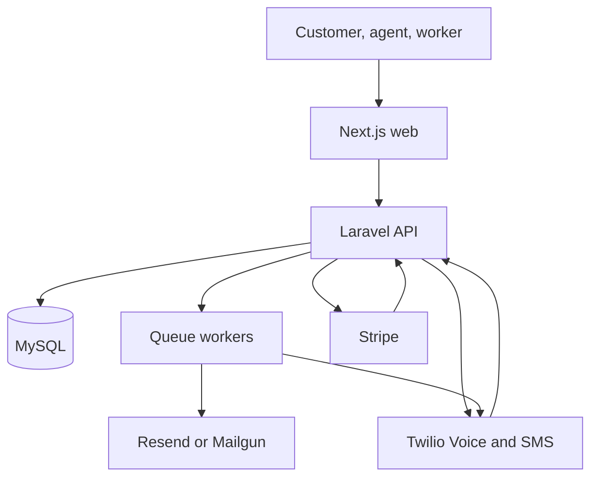
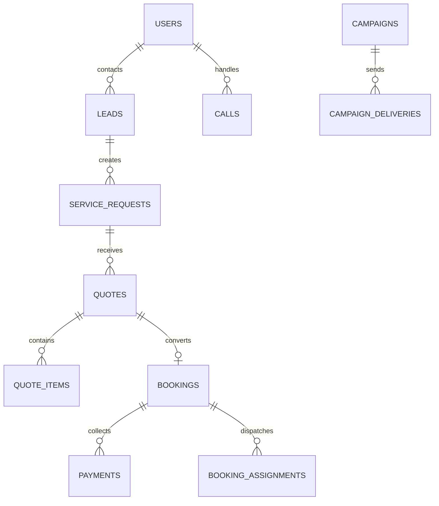
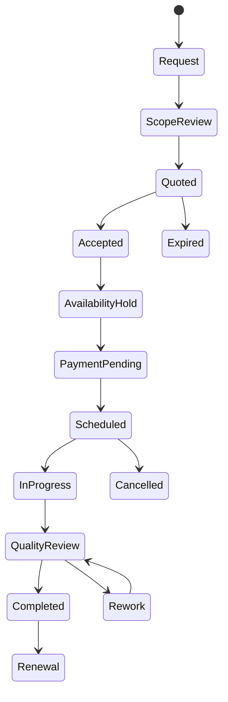

# Express Cleaning Consult — system architecture

**Version:** 1.0 design baseline · 28 September 2026  
**Audience:** owner, product, engineering, operations  
**Scope:** a single-business, extensible cleaning operations platform for `expresscleaningconsult.com`. “SaaS” describes the hosted application and its reusable modules; this design does not assume the business is selling software to other cleaning companies.

## 1. Business rules and source of truth

This design incorporates the September 25 Christine handoff and operations workbook, plus the business details previously supplied by the owner. The brand name is **Express Cleaning Consult**. The proposed public contact details from earlier conversations are `support@expresscleaningconsult.com` and `+1 281-972-7712`; verify these before publishing. The present requested palette (`#00A88F`, `#0B8B77`, `#E5E9F0`, `#D8DEE9`, `#FFFFFF`, `#FAFAFA`, `#1E293B`) supersedes older brand colors in the handoff.

| Established business detail | System consequence |
|---|---|
| Requests are reviewed for scope, price, cleaner availability and assignment before confirmation. | The default wizard ends in **Request a free quote**. No automatic charge, claimed availability, or confirmed appointment occurs until the office approves a quote and service slot. |
| No approved customer rate card or deposit percentage exists. | Store versioned pricing rules and deposit policies, initially disabled. Never publish “from $120” or calculate an invented final price. |
| Residential, deep, move-in/out, apartment turn, Airbnb/STR, office/commercial, janitorial, medical/professional office, retail, property management, post-construction, event, floor/common area and reachable interior glass services; fridge, oven, cabinet, linen and light organization extras. | A managed service catalog with explicit `request_only` and optional `instant_eligible` flags. Medical offices are non-biohazard unless independently qualified and scoped. |
| One-time, weekly, biweekly, monthly, recurring commercial and as-needed inquiries. | Frequency is captured on the request; only confirmed schedules create recurring plans. |
| Nationwide marketing intent, with Georgia and Lansing activity, but actual coverage depends on available crews. | Market records distinguish `marketing`, `active_request`, and `instant_enabled`. City SEO pages are published only for verified active coverage and unique local content. No nationwide availability promise. |
| Christine uses a workbook now; Square/Jobber may be temporary operations tools. | The Laravel database becomes authoritative only after a reconciled import/cutover. Keep external IDs and idempotent import mappings; do not create duplicate invoices or payments. |
| Workers need screening, approval, service-area matching, assignments, checklists and photo proof. | Separate worker role and private portal; approval gate before assignments; private object storage for photos and access instructions. |
| Customers should see only their own records; admin and call center are private. | Strong resource policies plus scoped queries; `/account`, `/worker`, `/admin` each get distinct authorization. |

### Product boundary

The **four visible steps** are (1) service/property, (2) preferred date/window and address, (3) extras and condition, and (4) review/contact. Step 4 shows either **request a quote** or, when a verified market, available crew, supported service and current approved price rule all exist, **pay deposit/full amount**. A date preference is never represented as a reserved slot until the server creates a hold/confirmed booking.

## 2. Deployment and service boundaries



| Boundary | Owns | Does not own |
|---|---|---|
| Next.js App Router | Server-rendered marketing/SEO pages, client booking wizard, customer/worker/admin interfaces, semantic form and interaction state | Trusted prices, payment state, agent authorization |
| Laravel REST API | Validation, RBAC, quote and booking state, pricing decisions, scheduling, CRM, provider adapters and webhooks | Raw card data, frontend-only status |
| MySQL | Users, leads, service requests, quotes, bookings, assignments, payments, calls, campaigns, consent, outbox and audit history | Media bytes or secrets |
| Queue workers | Emails, SMS, drip schedule, review requests, reconciliation, retries | Synchronous checkout confirmation |
| Stripe | Payment method collection, intents, refunds and subscriptions where approved | Business quote approval or job completion |
| Twilio | Browser calling and carrier delivery | CRM truth or consent decisions |
| Private object storage | Scope photos and proof of work, with short-lived signed URLs | Public SEO images |

Use two Railway web services (`web` and `api`) plus an `api-worker` process and managed MySQL. Place the first-party web and API on same-site subdomains, configure Sanctum stateful domains, secure cookies, CORS allowlist and CSRF. Laravel serves health endpoints independent of external providers. A queue backend should be shared between API and worker; the database queue is sufficient initially, Redis can replace it without changing jobs. Migration runs as an explicit release step, never on every web boot. Railway reads `railway.json` from the service root and builds a detected Dockerfile. [Railway configuration reference](https://docs.railway.com/config-as-code/reference) · [Railway Dockerfiles](https://docs.railway.com/builds/dockerfiles).

### Composition and accessibility

Server components own SEO, service catalog initial data, and immutable booking shell. Client components own the four-step form, calendar interaction and Stripe Elements, with a narrow boundary to limit hydration. Reserve image dimensions, use stable skeleton dimensions and font loading to avoid layout shift. Shared form fields and step layout use composition slots; validated values are passed to the API once. Every input has a visible label, error text tied by `aria-describedby`, a logical focus target when a step fails, `aria-live` progress updates, keyboard operability and visible focus. Honor reduced motion. Verify WCAG 2.1 AA with manual keyboard and screen reader checks; automated checks alone do not establish conformance. [Next.js components](https://nextjs.org/docs/app/getting-started/server-and-client-components) · [WCAG 2.1](https://www.w3.org/TR/WCAG21/).

## 3. Data ownership and normalized model

The required six tables are **users, leads, bookings, payments, calls, campaigns**. A functional normalized design also needs `service_types`, `markets`, `addresses`, `service_requests`, `quotes`, `quote_items`, `pricing_rules`, `booking_assignments`, `workers`, `media`, `campaign_deliveries`, `consents`, `provider_events`, and `audit_events` (plus Sanctum and Spatie package tables). Amounts are integer USD cents. Timestamps are UTC; booking windows include an IANA time zone. Public IDs are ULIDs; internal foreign keys are indexed. Store one `provider_event` per unique provider event ID to make webhook effects idempotent. Snapshot approved quote items and price-rule version before payment. PII is access controlled and retention scoped.



`lead.status` is sales context; it is not the sole source of truth for booking and payment. Do not use a single `Lead → Booked → In-Progress → Completed → Renewal` enum to hide quote, cancellation, rework and refund states. Derive the simplified dashboard stage from underlying states. Every mutation writes an actor/time audit event and, where needed, an outbox event in the same transaction.

## 4. State flow and invariants



1. A request can be submitted even outside an instant-enabled market; the office may decline it after review. Public forms cannot mark it `Scheduled`.
2. Quote acceptance records its revision and price snapshot. Staff must confirm available crew before a booking and may offer a different date. A short hold prevents double assignment.
3. A booking requiring payment becomes `Scheduled` only after server-side confirmation of the expected successful Stripe event and an available slot. Frontend success callbacks are informational.
4. **Deposit payment** means capture the approved deposit now, with a later balance invoice. **Manual authorization** is a separate option limited by the card network window; it is unsuitable for jobs booked far ahead. Stripe notes online card holds are often valid about seven days. [Stripe authorization guidance](https://docs.stripe.com/payments/place-a-hold-on-a-payment-method).
5. `Completed` requires quality review; send neutral feedback/review requests after completion to eligible, opted-in customers. Service issues route to recovery, without suppressing the customer's right to leave a review.
6. Retries, duplicate webhooks and out-of-order events must not advance a booking twice. Reconcile with Stripe by intent ID before resolving disputed state. [Stripe webhooks](https://docs.stripe.com/webhooks).

## 5. REST contracts (v1)

All JSON endpoints are prefixed `/api/v1`. Error shape: `{ "error": { "code": "...", "message": "...", "fields": { "field": ["..."] } }, "request_id": "..." }`. State-changing client calls require `Idempotency-Key`; rate limit public requests. Protected calls use first-party Sanctum cookies and CSRF. Agent actions also require Spatie permission plus record policy. Pagination is cursor based and filtered queries are indexed.

| Endpoint | Auth | Input / output and invariant |
|---|---|---|
| `GET /catalog?market=...` | public | Published service IDs, frequency/add-on choices, verified market status; never leaks draft rates. |
| `POST /requests` | public, throttled | Property, service, address, preferred slot, extras, condition, contact and channel-specific consent → `{ request_id, status: "received", next_step: "scope_review" }`. Server validates service and market. |
| `POST /quotes/preview` | public, throttled | Same scope → `{ eligible, estimate_cents?, currency, reason?, price_rule_version? }`; estimate only if an active approved rate rule applies; never binding. |
| `GET /requests/{id}` | customer/agent | Customer ownership policy or agent permission. Public request tracking uses separate scoped one-time token if enabled. |
| `POST /admin/requests/{id}/quotes` | quote manager | Scope line items, approved price, deposit policy, expiration and version → quote ID. |
| `POST /quotes/{id}/accept` | customer | Valid, unexpired quote revision → acceptance and availability check. |
| `POST /bookings/holds` | customer/agent | Accepted quote and desired slot → short hold token if capacity is available. Must be concurrency safe. |
| `POST /payments/intents` | customer | Confirmed quote/hold and amount mode `deposit|full` → Stripe `client_secret`, payment ID. Server calculates all amounts from snapshot. |
| `POST /webhooks/stripe` | signed provider | Raw body signature, unique event ID, idempotent payment/booking update; quickly acknowledge and queue heavy work. |
| `GET /account/bookings`, `GET /account/bookings/{id}/invoice.pdf`, `GET /account/plans`, `POST /account/plans/{id}/change-requests` | customer | Own bookings, invoice PDF, and staff-reviewed recurring plan requests. |
| `GET /admin/leads`, `GET /admin/leads/{id}`, `PATCH /admin/leads/{id}`, `PATCH /admin/leads/{id}/assignment` | agent/manager | Cursor pages, derived stages, disposition/follow-up and approved agent assignment with audit. |
| `GET /call-center/token` | call agent | Short-lived Twilio access token with scoped identity; browser Voice SDK uses this endpoint. |
| `POST /call-center/voice` | Twilio signed callback | TwiML App outbound call request, validated by Twilio signature; browser never calls it directly. |
| `POST /webhooks/twilio/voice`, `/status`, `/incoming` | signed provider | Validate Twilio signature and allowed dial target; TwiML or status updates. Never trust client-supplied From. |
| `POST /admin/calls/{id}/notes` | call agent | Save timestamped note, disposition, follow-up date; authorization and audit. |
| `POST /worker/jobs/{id}/complete` | approved worker | Checklist and evidence, then quality review; assignment policy. |
| `POST /admin/campaigns` | marketing manager | Segment, consent channel, schedule, template version, suppression rules; queue deliveries. |

Example request:

```json
{
  "service_code": "MOVE-OUT",
  "address": {"street": "...", "city": "Lansing", "region": "MI", "postal_code": "...", "country": "US"},
  "property": {"type": "residential", "square_feet": 1800, "bedrooms": 3, "bathrooms": 2, "condition": "moderate", "pets_on_site": false, "supplies_available": "unsure"},
  "preferred_start": "2026-10-15T09:00:00-04:00",
  "time_zone": "America/Detroit",
  "frequency": "one_time",
  "add_on_codes": ["FRIDGE"],
  "access_notes": "Parking is in the rear lot.",
  "contact": {"name": "...", "email": "...", "phone": "..."},
  "consent": {"transactional_sms": true, "marketing_email": false, "marketing_sms": false}
}
```

## 6. Pricing and provider integrations

Versioned `pricing_rules` are scoped by service, market, size band, room count, condition, frequency and add-on. Evaluation order: exact service + market → eligible size/condition → base amount + rooms + area + extras → approved discount/tax policy → deposit policy. Persist a detailed breakdown with `currency`, `rule_version`, and `expires_at`. If any required dimension has no approved rule, return `eligible=false` and a request-only response. Commercial, medical office, major deep cleans and post-construction default to manual scope review.

Stripe: use Elements on approved quote checkout; secret key only on Laravel. Generate an idempotency key for create/capture/refund operations. Verify webhook signature on raw body, log unique event IDs, re-fetch sensitive intent state as appropriate, and separate `authorized`, `captured`, `failed`, `refunded` records. Later recurring service scheduling is **not automatically a Stripe subscription**: the charge schedule needs a separately approved commercial policy and customer agreement.

Twilio: issue short-lived browser Voice SDK access tokens to authorized agents; TwiML App handles outbound requests; validate number format, permitted destinations and identity on server. Inbound number routes to a recently heartbeating available agent; otherwise the caller hears an unavailable message. Validate Twilio webhook signatures and record call SID/status. A phone match helps associate an inbound call with a lead, but call note access still requires the assigned agent identity. [Twilio Voice JavaScript SDK](https://www.twilio.com/docs/voice/sdks/javascript) · [Twilio webhook security](https://www.twilio.com/docs/usage/webhooks/webhooks-security).

Marketing: `campaigns` define a template/segment; `campaign_deliveries` is the outbox. Honor separate transactional and marketing consent, opt-out, quiet hours and delivery suppression. Queue idle-lead follow-up only after a defined inactivity threshold; a scheduled job suppresses lead nurturing. Post-clean review messages go to every eligible customer neutrally. Templates and timing are owner-configurable.

The current review job is queued after a quality-confirmed completion, delayed by `REVIEW_DELAY_HOURS`, and sent once to customers with explicit `review_email` consent. A `review_requests` record is unique per booking. It suppresses unconfigured and ineligible sends; ambiguous provider outcomes require operator reconciliation before any retry. Recurring plans are operational records and do not create Stripe subscriptions or future charges.

## 7. SEO and content controls

`/services/[city]/[service-type]` resolves only published, active market/service pairs with locally useful copy. Unknown or unverified pairs return 404 and are omitted from the sitemap. The marketing homepage can say the business handles inquiries across the USA, while each service page states confirmed coverage precisely. Generate canonical URLs, metadata and XML sitemap from published rows. Use Schema.org `LocalBusiness` for the real business identity where location details are verified, and `Service` with `serviceType: "Cleaning service"` plus `areaServed` for offerings. **`CleaningService` is not a verified Schema.org type**; do not emit it as `@type`. Do not invent street addresses, reviews, guarantees or geographic coverage. [Schema.org Service](https://schema.org/Service) · [Google LocalBusiness guidance](https://developers.google.com/search/docs/appearance/structured-data/local-business) · [Next.js sitemap](https://nextjs.org/docs/app/api-reference/file-conventions/metadata/sitemap).

## 8. Security, operations and release gates

- Role permissions: owner/admin, sales agent, dispatcher, marketing agent, approved worker and customer; deny by default. Agent notes and customer PII must be restricted; support staff should have only the access necessary for assigned work.
- Encrypt transport; keep provider keys in Railway secrets; rotate on incident. Never log card data, Twilio tokens, access codes or private photo URLs. Apply upload content/type limits, malware scanning policy, private storage and expiring URLs.
- Record consent timestamp/source/version, audit price overrides and status transitions. Rate limit public forms and dialer actions, enforce allowed call destinations, and monitor spend.
- MySQL backups and tested restore, queue dead-letter/retry procedure, provider webhook replay tooling, database migration rollback plan, health checks, alerts for failed payment/call delivery, and per-service structured logs with request ID.
- Before go-live: approve prices and deposit/refund/cancellation terms, confirm served ZIPs and crew capacity, verify public contact details and domain routing, provision Stripe/Twilio/email credentials, test payment and webhook edge cases, complete privacy/consent copy, run keyboard and mobile checks, and reconcile workbook/Square/Jobber historical records.

## 9. Delivery sequence

1. **Architecture:** this document and contracts.
2. **Schema:** migration tables, keys, indexes and state constraints.
3. **Front end:** accessible four-step request-first wizard and conditional payment path.
4. **API:** services/controllers, RBAC, Stripe/Twilio adapters, CRM and queue jobs.
5. **Deployment:** service-specific Dockerfiles and Railway configuration, environment map and verification.

The code may be deployed only after the release gates in section 8 have been exercised with real accounts and approved business rules. Code structure alone does not establish production readiness.
